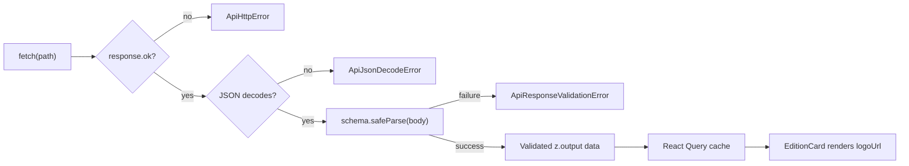

# Post-mortem: Editions response validation contract drift

- Date: 2026-07-17
- Status: Analysis complete; remediation not implemented
- Affected flow: `GET /api/almanac/editions` → API client → Zod validation → React Query → editions screen
- Confirmed impact: Development flow blocked by incompatible response contracts; edition logos could not be adopted safely
- Production impact: Not established from the available evidence

## Executive summary

The editions frontend was changed to require a top-level `logoUrl` based on a proposed response payload. The live local provider was not first verified and changed to that contract. A later direct request to `http://localhost:3000/api/almanac/editions` returned HTTP 200 and valid JSON, but each edition still contained `host.flagUrl` and did not contain `logoUrl`.

Zod validation was not the cause of the incident. It correctly detected that the consumer and provider disagreed. The failure was contract management: the consumer schema, UI, provider response, and verification process were allowed to describe different shapes.

The correct solution is to keep runtime response validation and make it reliable:

1. Define one Zod schema per endpoint response and infer TypeScript types from it.
2. Make the API boundary accept a schema and validate an `unknown` JSON body exactly once.
3. Distinguish HTTP, JSON-decoding, and response-validation failures.
4. Deploy response changes additively, provider first and consumer second.
5. Exercise the real fetcher with contract fixtures and the live/staging provider before declaring the change complete.

No application code was changed as part of this post-mortem.

## What happened

### Desired contract supplied for the logo change

```json
{
  "editions": [
    {
      "id": "0e532d07-4065-4608-91e7-b51af67d69cf",
      "year": 2022,
      "path": "/editions/2022",
      "pageNumber": 4,
      "logoUrl": "https://pub-ad9a25475486494b8665c0b11bd920ca.r2.dev/editions/2022-logo.svg",
      "host": {
        "displayName": "Qatar"
      }
    }
  ]
}
```

### Provider response observed during this post-mortem

On 2026-07-17, a direct request to the configured local provider returned HTTP 200 with `Content-Type: application/json; charset=utf-8` and this shape:

```json
{
  "editions": [
    {
      "id": "0e532d07-4065-4608-91e7-b51af67d69cf",
      "year": 2022,
      "path": "/editions/2022",
      "pageNumber": 4,
      "host": {
        "displayName": "Qatar",
        "flagUrl": "https://pub-ad9a25475486494b8665c0b11bd920ca.r2.dev/lorem ipsum"
      }
    }
  ]
}
```

The collection envelope is an object containing `editions`; it is not a bare array. The observed item has `host.flagUrl` and no `logoUrl`. A final schema that requires `logoUrl` must reject this response.

### Contract differences

| Location | Desired | Observed provider | Compatibility |
| --- | --- | --- | --- |
| Response root | `{ editions: Edition[] }` | `{ editions: Edition[] }` | Compatible |
| `edition.logoUrl` | Required string URL | Missing | Breaking |
| `edition.host.displayName` | Required string | Present | Compatible |
| `edition.host.flagUrl` | Removed from desired contract | Present | Additive if the consumer allows unknown fields |

## Timeline

1. The original frontend API boundary returned JSON as `unknown`.
2. Domain fetchers called Zod `.parse()` and returned inferred response types.
3. A new desired payload was supplied in which `logoUrl` moved to the edition summary and `host.flagUrl` disappeared.
4. The frontend schema and card were changed against the desired payload without first proving that the provider returned it.
5. A production build passed. This only proved that TypeScript and Vite could compile the code; it did not execute the API request or validate a provider response.
6. A browser check displayed edition logos, but the exact response used by that check was not captured and compared with the provider response as a contract artifact. A later direct provider request returned the legacy flag shape. The reason for that discrepancy is not established by the available evidence and must not be guessed.
7. Work began moving from Zod validation to a generic `API.get<T>()` and a separate `types.ts`. That avoids the visible Zod error but removes runtime protection and introduces a second contract definition. It is not an acceptable remediation.
8. This post-mortem was requested before further implementation.

## Root-cause analysis

### Primary root cause

The provider and consumer contract changes were not sequenced or verified together. The frontend was changed to require a field that the directly observed provider did not return.

### Five whys

1. **Why did response validation fail?**  
   The schema required `editions[n].logoUrl`, but the provider response did not include it.

2. **Why did the schema and provider disagree?**  
   The schema was updated from a proposed/pasted payload, while the provider remained on the legacy `host.flagUrl` response.

3. **Why was the consumer changed before the provider contract was proven?**  
   There was no enforced provider-first rollout or contract-verification gate.

4. **Why did normal verification not stop the change?**  
   The build did not perform a request, and the browser check was treated as sufficient without retaining and validating the exact response body used.

5. **Why could the same class of mistake recur?**  
   The contract exists in multiple mutable representations—provider code, pasted examples, Zod schemas, separate TypeScript types, UI assumptions, and mocks—with no single ownership rule or automated contract test connecting them.

### Contributing factors

- A raw `ZodError` does not identify the endpoint or distinguish a provider contract violation from transport or JSON errors.
- The screen reduces every failure to “Unable to load editions,” hiding the useful failure category during development.
- TanStack Query retries failed client queries by default. A deterministic schema mismatch should not be retried.
- A generic `API.get<T>()` can make incorrect code compile because TypeScript types are erased at runtime; it does not validate JSON.
- A separate `types.ts` duplicates information already represented by Zod and can drift from the runtime schema.
- Changing the response root from `{ editions: [...] }` to a bare array would contradict the directly observed provider response and create a second bug.
- No test exercises the real editions fetcher against both a valid contract fixture and representative invalid responses.
- No provider contract test prevents the backend from returning the legacy shape after the consumer adopts the new one.

### Causes ruled out by the available evidence

- **Capacity:** the response contains eight edition summaries; there is no evidence of load, latency, or payload-size pressure.
- **HTTP transport:** the directly observed request returned HTTP 200.
- **JSON decoding:** the directly observed body was valid JSON.
- **Zod malfunction:** the desired schema and observed body are structurally incompatible, so rejecting the body is correct behavior.
- **R2 rendering:** image loading happens after the response has passed validation; it cannot cause a missing `logoUrl` validation issue.

## What Zod did correctly

Zod is supposed to reject untrusted input that does not match the schema. Its `.safeParse()` API returns a discriminated success/failure result, and `z.infer`/`z.output` derives the static type from the runtime schema. The validation error is therefore evidence that the boundary worked; removing the boundary would hide the contract defect rather than fix it.

The improvement is to turn Zod’s granular issues into a domain-specific response-validation error with endpoint context. Zod 4 provides structured issues and formatting utilities such as `z.prettifyError()` and `z.treeifyError()`.

## Research findings

The proposed solution follows these documented behaviors:

- [Zod basic usage](https://zod.dev/basics) documents `.safeParse()` for explicit success/failure handling and type inference from schemas.
- [Zod object schemas](https://zod.dev/api?id=objects) distinguish default objects, strict objects, and loose objects. Default `z.object()` strips unknown fields, which is useful for additive provider changes without weakening validation of required fields.
- [Zod error formatting](https://zod.dev/error-formatting) provides structured and human-readable representations of validation issues.
- [TypeScript’s erased types](https://www.typescriptlang.org/docs/handbook/typescript-from-scratch#erased-types) confirm that generic type parameters do not exist at runtime. `API.get<T>()` is a compile-time assertion, not response validation.
- [MDN’s Fetch guidance](https://developer.mozilla.org/en-US/docs/Web/API/Fetch_API/Using_Fetch) explains that `fetch()` does not reject for HTTP error status codes; clients must check `response.ok` and separately decode the body.
- [TanStack Query query functions](https://tanstack.com/query/latest/docs/framework/react/guides/query-functions) require failed query functions to throw or return a rejected promise so the error reaches query state.
- [TanStack Query retries](https://tanstack.com/query/latest/docs/framework/react/guides/query-retries) support a retry function based on the error. Deterministic validation and JSON-decoding errors should return `false`.
- [Vitest request mocking](https://main.vitest.dev/guide/mocking/requests) recommends Mock Service Worker for request-level tests. MSW is already a project dependency.
- [Pact consumer-test guidance](https://docs.pact.io/consumer) recommends exercising the real API client and keeping contracts loose enough to tolerate non-breaking additions.
- [OpenAPI](https://spec.openapis.org/oas/latest.html) is the standards-based option for a provider-owned, language-independent API description if this project later needs generated or shared contracts.

## Chosen design

### Design principles

1. JSON from `response.json()` is `unknown` until validated.
2. Each endpoint has one authoritative consumer schema.
3. TypeScript response types are inferred from that schema; they are not written separately.
4. Validation occurs once, at the API boundary.
5. Required fields remain strict; unrelated additive fields do not break consumers.
6. Error categories remain distinct and observable.
7. A contract change is deployed additively and verified before the consumer requires it.

### Target request path



### Target editions schema

The final consumer schema should represent the exact envelope and fields needed by the screen:

```ts
const editionSummarySchema = z.object({
  id: z.string().uuid(),
  year: z.number().int(),
  path: z.string(),
  pageNumber: z.number().int(),
  logoUrl: z.url(),
  host: z.object({
    displayName: z.string(),
  }),
})

export const editionsResponseSchema = z.object({
  editions: z.array(editionSummarySchema),
})

export type EditionSummary = z.output<typeof editionSummarySchema>
export type EditionsResponse = z.output<typeof editionsResponseSchema>
```

Important decisions:

- Keep the `{ editions: [...] }` envelope because it is present in both the desired payload and the directly observed provider response.
- Use standard `z.object()`, not `z.strictObject()`. Required known fields are validated, while the provider may temporarily retain `host.flagUrl` during an additive rollout.
- Make `logoUrl` required in the final consumer contract. Do not silently fall back to a flag when the product requirement is to display an edition logo.
- Do not create a separate handwritten response type.

### Target API boundary

The shared API helper should accept the endpoint path and its Zod schema:

```ts
async function apiGet<TSchema extends z.ZodType>(
  path: string,
  schema: TSchema,
): Promise<z.output<TSchema>>
```

Its internal sequence should be:

1. Execute `fetch`.
2. On a non-2xx response, decode a best-effort error body and throw `ApiHttpError` with status and URL.
3. Decode the success body in a dedicated `try/catch`; throw `ApiJsonDecodeError` if JSON parsing fails.
4. Call `schema.safeParse(body)`.
5. On failure, throw `ApiResponseValidationError` containing:
   - endpoint path and resolved URL;
   - HTTP status;
   - Zod issue paths, codes, and messages;
   - a concise top-level received-shape summary;
   - the original error as `cause` where supported.
6. Do not retain or log the entire response body by default. A generic API client may later handle sensitive payloads.
7. Return only `result.data` on success.

The editions fetcher then becomes conceptually:

```ts
API.get('/api/almanac/editions', editionsResponseSchema)
```

This retains runtime validation without making every fetcher repeat parsing and error-wrapping logic.

### Error and retry policy

| Error category | Example | Retry automatically? | UI behavior |
| --- | --- | --- | --- |
| Network error | Connection interrupted | Yes, bounded | Generic temporary failure |
| HTTP 5xx | Provider unavailable | Yes, bounded | Generic temporary failure |
| HTTP 408/429 | Timeout/rate limit | Conditional | Generic temporary failure |
| Other HTTP 4xx | Unauthorized/not found | No | Endpoint-appropriate message |
| JSON decode | HTML or truncated body with 2xx | No | Generic data failure; detailed development diagnostics |
| Zod validation | Missing `logoUrl` | No | Generic data failure; detailed development diagnostics |

The React Query retry function should return `false` for JSON-decoding and response-validation errors. Retrying the same incompatible payload wastes requests and delays the useful error.

### Provider-first additive rollout

The provider change must precede the consumer requirement:

1. Add `logoUrl` to every edition summary while retaining `host.flagUrl` temporarily.
2. Verify the provider response directly in local/staging environments.
3. Deploy the frontend schema that requires and renders `logoUrl`.
4. Because normal `z.object()` ignores extra keys, the temporary `host.flagUrl` does not break the new consumer.
5. Remove `host.flagUrl` from the editions response only after all consumers are known to have migrated.

If the provider cannot add `logoUrl`, the frontend change must not ship. Constructing the R2 URL from `year` in the client would create an undocumented second source of truth and is not the recommended fallback.

## Detailed implementation plan

This section is a plan only. None of these application changes were made during this post-mortem.

### Phase 0: Reconcile and freeze the contract

1. Preserve the current dirty worktree; do not overwrite staged or unstaged edits.
2. Designate the provider response as the transport source of truth and the Zod schema as the frontend consumer contract.
3. Confirm that the target response is the supplied `{ editions: [...] }` envelope with required top-level `logoUrl`.
4. Confirm that all supported edition logo objects exist and return successful SVG responses.
5. Save one sanitized legacy fixture and one target fixture for regression tests.

**Exit criterion:** provider owner and frontend owner agree on one target JSON example and required/optional fields.

### Phase 1: Change the provider additively

Affected system: backend serving `GET /api/almanac/editions` (not present in this workspace).

1. Add `logoUrl` to the edition summary read model.
2. Populate it from the edition visual-identity/logo asset source, not by duplicating URL string construction across controllers.
3. Keep `host.flagUrl` during the transition.
4. Add a provider test asserting:
   - root is an object with `editions`;
   - every edition has a UUID `id`, integer `year`, `path`, integer `pageNumber`, URL `logoUrl`, and `host.displayName`;
   - the eight current editions return the expected year-specific logo URL;
   - no `logoUrl` is null or blank.
5. Deploy to local/staging and capture the real response.

**Rollback:** revert the additive field without affecting the old frontend, because `host.flagUrl` remains available.

**Exit criterion:** direct local/staging requests match the target fixture and every logo URL returns a non-empty SVG.

### Phase 2: Establish the validated API boundary

Affected files:

- `src/api/index.ts`
- new colocated API error tests

Planned changes:

1. Replace the generic-only `API.get<T>(path)` assertion with `API.get(path, schema)`.
2. Keep the decoded body typed as `unknown` until `safeParse` succeeds.
3. Introduce the three explicit error categories described above.
4. Format validation issues into concise diagnostics with endpoint context.
5. Ensure production-facing messages do not expose response bodies or internal schema details.

**Rollback:** restore the previous API helper while leaving endpoint schemas intact.

**Exit criterion:** unit tests prove correct classification of non-2xx, invalid JSON, invalid schema, and valid responses.

### Phase 3: Make the editions schema authoritative

Affected files:

- `src/domains/editions/schemas.ts`
- `src/domains/editions/types.ts` if it exists in the reconciled worktree
- `src/domains/editions/fetchers.ts`

Planned changes:

1. Restore/retain the object envelope.
2. Add required `logoUrl` to `editionSummarySchema`.
3. Remove `host.flagUrl` from the fields consumed by this endpoint schema; tolerate it as an unknown transitional field.
4. Export `EditionSummary` and `EditionsResponse` using `z.output`.
5. Remove duplicate handwritten editions response types.
6. Pass `editionsResponseSchema` to the API helper from `getEditions`.
7. Apply the same boundary pattern to `getEdition` using its existing detail schema.

**Rollback:** revert the consumer to the legacy schema and card before removing `host.flagUrl` from the provider.

**Exit criterion:** the real fetcher returns inferred, validated data from the target fixture and rejects the legacy fixture with an issue at `editions[0].logoUrl`.

### Phase 4: Render the edition logo

Affected files:

- `src/domains/editions/edition-card.tsx`
- `src/domains/editions/screen.tsx` only if its current edits require reconciliation

Planned changes:

1. Render `edition.logoUrl` unconditionally after validated data reaches the card.
2. Use an accessible label containing the host, year, and “World Cup logo.”
3. Preserve the existing layout unless visual review shows the tall logos require a deliberate size adjustment.
4. Do not add a flag fallback.

**Exit criterion:** all eight cards render loaded images with non-zero intrinsic dimensions and no broken-image fallback text.

### Phase 5: Add contract-focused tests

This introduces a testing convention and therefore requires explicit developer approval under `AGENTS.md`.

Recommended tooling: Vitest plus the already-installed MSW, installed and run with pnpm 11+.

Planned test coverage:

1. **Schema tests**
   - target wrapped response succeeds;
   - legacy response without `logoUrl` fails at the expected path;
   - bare-array response fails at the root;
   - extra unrelated keys succeed and are stripped;
   - malformed UUID, year, path, and URL fail.
2. **API-boundary tests**
   - non-2xx → `ApiHttpError`;
   - 2xx invalid JSON → `ApiJsonDecodeError`;
   - 2xx incompatible JSON → `ApiResponseValidationError` with endpoint and issues;
   - compatible JSON → inferred parsed data.
3. **Fetcher contract test**
   - exercise the real `getEditions` function through MSW;
   - do not call the schema directly as a substitute for testing the consumer;
   - verify the exact request path and parsed result.
4. **Screen regression test**
   - valid response produces eight edition-logo images;
   - validation error produces the intended error state.
5. **Provider verification**
   - preferred immediate option: provider-owned endpoint test using the agreed fixture/shape;
   - future option: OpenAPI or Pact if frontend and backend are deployed independently enough to justify the extra tooling.

**Exit criterion:** contract tests fail when `logoUrl` is removed, the envelope becomes a bare array, or the fetcher bypasses validation.

### Phase 6: Configure query behavior and diagnostics

Affected files/systems:

- editions query options or the shared Query Client policy
- development logging/telemetry boundary

Planned changes:

1. Disable retries for response-validation and JSON-decoding errors.
2. Keep bounded retries for network and selected server failures.
3. Preserve a generic user-facing error message.
4. In development, expose the error category, endpoint, and formatted Zod issue paths.
5. If production telemetry exists, record a sanitized `api_response_validation_failed` event with endpoint, status, schema name/version, and issue paths—never the complete body by default.

**Exit criterion:** one incompatible response produces one request, a clear diagnostic, and no retry delay.

### Phase 7: Release and cleanup

1. Deploy provider additive response.
2. Run direct provider contract verification.
3. Deploy validated frontend consumer.
4. Run the staging smoke check against the deployed provider.
5. Monitor HTTP and response-validation errors.
6. Remove legacy `host.flagUrl` only in a later provider release.
7. Record the final contract in OpenAPI if/when the team approves provider-owned formal contracts.

## Verification matrix

| Check | Build only | Schema test | Fetcher/MSW test | Live/staging smoke |
| --- | ---: | ---: | ---: | ---: |
| TypeScript compiles | Yes | Yes | Yes | No |
| Desired fixture matches schema | No | Yes | Yes | Indirectly |
| Real fetcher uses validation | No | No | Yes | Yes |
| Provider returns `logoUrl` | No | No | No | Yes |
| Response envelope is correct | No | Yes | Yes | Yes |
| R2 logo objects load | No | No | Optional | Yes |
| Validation errors are classified | No | Yes | Yes | Yes |

No single check is sufficient. Completion requires build, contract tests, and a provider-backed smoke check.

## Acceptance criteria

The remediation is complete only when all of the following are true:

1. `GET /api/almanac/editions` returns HTTP 2xx JSON with `{ editions: [...] }`.
2. Every edition contains a required, valid `logoUrl`.
3. The Zod schema validates the live/staging response without weakening `logoUrl` to optional.
4. TypeScript types are inferred from the schema, with no duplicate response interface.
5. The fetcher cannot return unvalidated JSON.
6. Validation failures include endpoint and issue-path context.
7. React Query does not retry deterministic contract failures.
8. Contract tests cover valid, legacy, bare-array, malformed, and additive-field cases.
9. All eight cards render edition logos with non-zero intrinsic image dimensions.
10. The provider-first rollout and rollback are demonstrated in staging.

## Alternatives considered

| Option | Runtime safety | Drift prevention | Complexity | Decision |
| --- | --- | --- | --- | --- |
| `API.get<T>()` with handwritten types | None | Poor | Low | Rejected |
| Per-endpoint Zod `.parse()` in every fetcher | Strong validation, weak diagnostics consistency | Moderate | Low | Viable but not preferred |
| Schema-aware shared API boundary + domain Zod schemas | Strong | Strong within frontend | Moderate | Recommended now |
| Provider-owned OpenAPI with generated clients/schemas | Strong if generation and CI are enforced | Strong across repositories | Medium/high | Recommended future evaluation |
| Pact consumer/provider verification | Strong across independently deployed services | Strong | High operational overhead | Defer unless deployment independence justifies it |

## Decisions requiring developer approval before implementation

These are high-impact conventions under `AGENTS.md` and must not be implemented implicitly:

1. Approve `API.get(path, schema)` as the shared response-validation boundary for this frontend.
2. Approve schema-inferred types and removal of duplicate handwritten API response types.
3. Approve Vitest + MSW as the frontend contract-testing strategy and the corresponding package/script changes.
4. Approve the retry classification policy, especially shared versus per-query configuration.
5. Confirm backend ownership and approve the provider-first additive rollout.
6. Decide whether OpenAPI should become the longer-term cross-repository source of truth; Pact remains optional and deferred.

## Prevention checklist for future response changes

Before changing a fetched response contract:

1. Capture the actual local/staging response directly from the provider.
2. Compare the current, desired, and transitional shapes field by field.
3. Decide whether the change is additive or breaking.
4. For breaking changes, design an additive transition.
5. Change and verify the provider first.
6. Update one Zod schema and infer its types.
7. Exercise the real fetcher with a valid and legacy fixture.
8. Verify retry and error-class behavior.
9. Run the build.
10. Run a provider-backed smoke check and capture the response used.
11. Remove legacy fields only after consumers have migrated.

## Final conclusion

The incident was not caused by Zod being incapable of validating an ordinary JSON response. The directly observed provider and the desired consumer contract were different. Zod surfaced that fact. The durable fix is a schema-aware API boundary, schema-inferred types, explicit error categories, real consumer contract tests, and an additive provider-first rollout.

Removing runtime validation or replacing it with `API.get<T>()` would make the failure quieter, not make the system correct.
